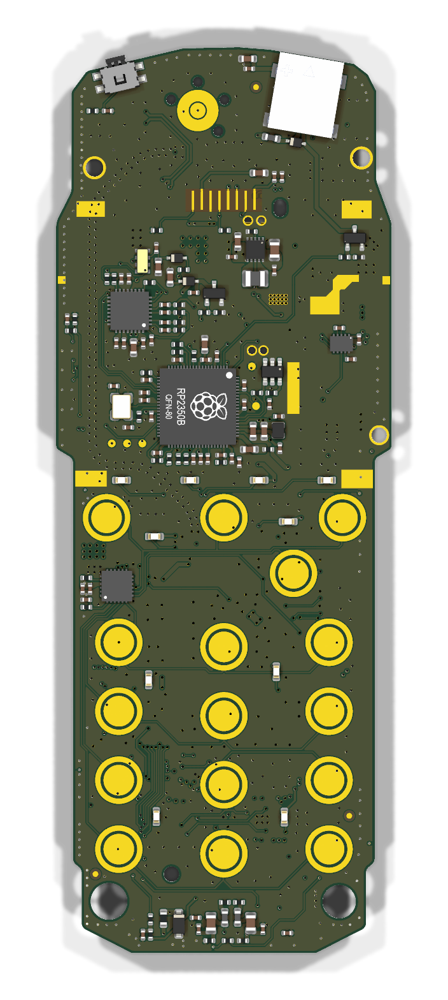
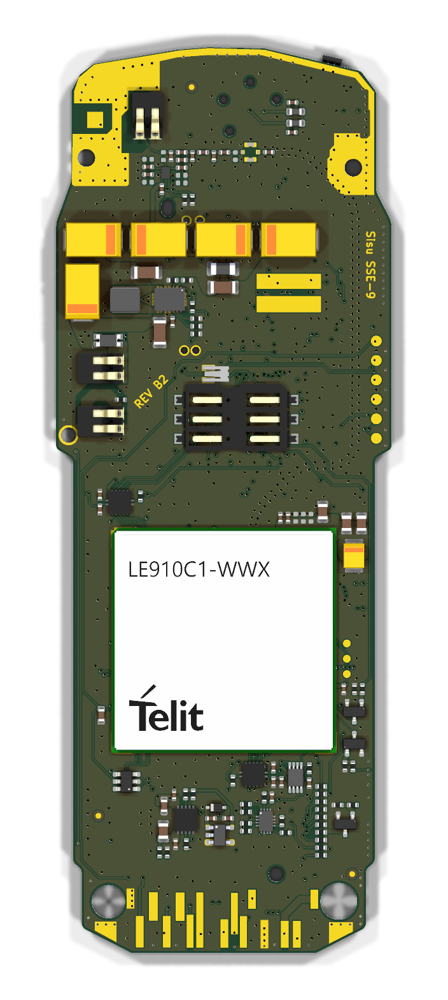

# Sisu SSE-9

Sisu SSE-9 is an experimental six-layer replacement mainboard for the Nokia
3210 mechanical platform. It keeps the original enclosure, keypad, display,
audio contacts, battery contacts, and bottom connector while replacing the
electronics with an RP2354B application controller and a Telit LE910C1-WWX LTE
module.

Rev B2 has been fabricated and hand assembled. The board is suitable for
development and bring-up, but it is not a drop-in production design.

> [!WARNING]
> Rev B2 has known hardware faults and required post-assembly rework. Read
> [ERRATA.md](ERRATA.md) before ordering, assembling, or powering a board.

| Front | Back |
| --- | --- |
|  |  |

## Key Features

- RP2354B microcontroller with local QSPI flash
- Telit LE910C1-WWX LTE modem and configurable antenna matching networks
- TCA8418 keypad scanner for the original dome-key matrix
- NAU88C22 audio codec with the original earpiece, microphone, speaker, and buzzer interfaces
- BQ25171 dual-chemistry charger support for NiMH and Li-ion development
- LTC2959 charge and current measurement
- RV-8803-C7 real-time clock
- Local symbols, footprints, and 3D models needed by the design
- Service/debug pogo adapter under `subassemblies/debug_pogo_adapter`

## Repository Layout

- `Sisu_SSE-9.kicad_pro`: main KiCad project
- `Sisu_SSE-9.kicad_pcb`: Rev B2 mainboard layout
- `*.kicad_sch`: root and hierarchical schematics
- `lib_10/`: project-local symbols, footprints, and 3D models
- `Sisu_SSE-9_bom_filled.xlsx`: grouped BOM with sourcing and review notes
- `Ordering/`: historical manufacturing archives for fabricated revisions
- `subassemblies/debug_pogo_adapter/`: pogo-to-JST service adapter
- `ERRATA.md`: known Rev B2 faults, rework, and validation limits

## Opening the Project

The current files are saved with KiCad 10.0.5. Clone the repository and open
`Sisu_SSE-9.kicad_pro` from KiCad's project manager. The symbol and footprint
tables use project-relative paths, so no shared user library is required.

```sh
git clone https://github.com/briskspirit/Sisu_SSE-9.git
cd Sisu_SSE-9
```

Older KiCad releases cannot read this project's file format reliably.

## BOM and Assembly

`Sisu_SSE-9.csv`, `Sisu_SSE-9_bom_filled.csv`, and
`Sisu_SSE-9_bom_filled.xlsx` are generated from the current post-assembly Rev
B2 source. The filled workbook retains supplier-review notes, but stock status
is only a historical snapshot and must be checked again before ordering.

RF tuning positions intentionally have no final MPN. Their values are
provisional and depend on the antenna, enclosure, assembly, and calibration.
Mechanical contact footprints such as the display zebra, speaker, motor, and
spring contacts remain visible in the engineering BOM but are excluded from
placement output.

## Manufacturing Archives

The ZIP files under `Ordering/` are immutable records of data sent for previous
fabrication runs. They are useful for comparison, not as the preferred source
for another order. The root KiCad files include post-assembly corrections that
are newer than the Rev B2 archive.

Before fabrication:

1. Read [ERRATA.md](ERRATA.md).
2. Run ERC and DRC with KiCad 10.0.5.
3. Re-export Gerbers, drill files, position files, and the BOM from the root project.
4. Review every fabrication output independently, especially RF footprints, plated holes, and DNP status.

## Current Status

- Rev A established the mechanical and electrical baseline.
- Rev B1 used the u-blox LARA-R6 modem.
- Rev B2 moved to the Telit LE910C1-WWX and is under hardware bring-up.
- Rev C is planned to address the published errata and power-management findings.

Firmware is developed in the sibling `Sisu_DCP-3` project and will be linked
here when its public repository is available.

## Contributing

Issue reports, measurements, footprint corrections, and tested design changes
are welcome. Please identify the board revision, modem variant, battery
chemistry, and the exact test conditions. Hardware changes should include ERC
and DRC results plus a review of generated fabrication data.

## License

Original project material is released under the [Unlicense](COPYING).
Third-party material remains the property of its respective owners; see
[THIRD_PARTY_NOTICES.md](THIRD_PARTY_NOTICES.md).

## Acknowledgements

- KiCad and its library contributors
- Raspberry Pi, Telit, Texas Instruments, Nuvoton, Micro Crystal, and the other component manufacturers whose documentation made this work possible
- The original Nokia 3210 engineering and industrial-design teams

Nokia is a trademark of Nokia Corporation. This is an independent hobby project
and is not affiliated with or endorsed by Nokia, HMD Global, Telit, Raspberry
Pi, or any component manufacturer.
